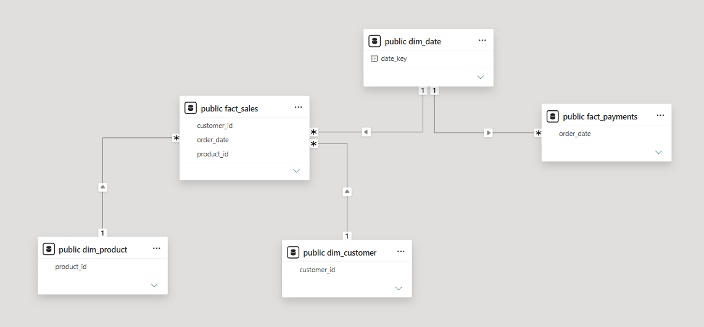

# Introduction

**This project is an end-to-end E-commerce Sales Analytics Dashboard**, built using the Olist Brazilian E-commerce dataset. **The dashboard provides visibility into sales performance, product categories, customer behavior, geographic distribution, payment methods, and operational efficiency.** By leveraging a star schema data model and multiple analytical views, stakeholders can explore key business metrics and identify trends that drive business performance.

# Background

As e-commerce businesses generate large volumes of transactional data, understanding sales trends, customer purchasing behavior, product performance, and delivery operations becomes critical for decision-making. This project simulates a real-world business intelligence workflow by building a structured data warehouse, creating analytical data models, and developing interactive dashboards for business reporting.

### Key business questions addressed include:

- **How is revenue performing over time?**

- **Which product categories generate the highest revenue?**

- **Which states and cities contribute the most sales?**

- **How do delivery performance and freight costs impact operations?**

- **What payment methods are most commonly used?**

- **How satisfied are customers based on review scores?**


# Tools I Used

### PostgreSQL

* **Data storage and management**
* **Fact and dimension table implementation**
* **Star schema design**

### DBeaver

* **Database administration and querying**
* **SQL development and testing**
* **Data modeling workflow**

### Power BI

* **Interactive dashboard development**
* **KPI reporting and business visualization**
* **DAX calculations for creating measures and calculated columns**
* **Data storytelling and reporting**

### SQL

* **Data cleaning and transformation**
* **Business analysis and aggregation**
* **Revenue, customer, product, and operational analysis**

### Olist E-commerce Dataset

* **Orders**
* **Customers**
* **Products**
* **Payments**
* **Reviews**
* **Geolocation data**

<details>
<summary><b>Click to View SQL: Fact Sales Dimension Star Schema Setup</b></summary>

```sql
CREATE TABLE fact_sales AS (
WITH reviews AS (
    SELECT
        order_id,
        review_score,
        ROW_NUMBER() OVER (
            PARTITION BY order_id
            ORDER BY review_answer_timestamp DESC
        ) AS rn
    FROM order_reviews_dataset
)
SELECT
    o.order_id,
    oi.order_item_id,
    o.customer_id,
    c.customer_unique_id,
    oi.product_id,
    oi.seller_id,
    CAST(o.order_purchase_timestamp AS DATE) AS order_date,
    o.order_status,
    o.order_purchase_timestamp,
    o.order_delivered_customer_date,
    o.order_estimated_delivery_date,
    oi.price,
    oi.freight_value,
    r.review_score
FROM orders_dataset AS o
INNER JOIN order_items_dataset AS oi
    ON o.order_id = oi.order_id
INNER JOIN customers_dataset AS c
    ON o.customer_id = c.customer_id
LEFT JOIN reviews AS r
    ON o.order_id = r.order_id
   AND r.rn = 1
);
```

</details>

<h3 align="center">Data Architecture & Modelling</h3>
<p align="center">
  
</p>

# The Analysis

### 1. Executive Sales Performance (**How is revenue performing over time?**)

<p align="center">
  
</p>

This analysis focuses on high-level financial health, tracking revenue momentum and high-volume sales periods to understand overall platform growth.

#### Key Findings & Metrics:

- **Total Revenue:** **R$ 7.14M** generated over the **2017 fiscal period**, driven by a total volume of **44,579 orders**.

- **Seasonality & Spikes:** A **massive revenue surge** occurs in **November** (reaching a peak of over **R$ 1M**), directly driven by **Black Friday campaigns**. Revenue scales up consistently from **Q1 to Q4**, demonstrating strong platform adoption.

- **Delivery Buffers:** On average, actual delivery times are significantly shorter than the estimated deadlines provided to customers, creating an intentional, operational safety net.

<details>
<summary><b>Click to View DAX: Total Revenue Using Measure</b></summary>

```DAX
Total Revenue = 
SUM('public fact_sales'[price]) + SUM('public fact_sales'[freight_value])
```

</details>

### 2. Product Category (**Which product categories generate the highest revenue? & How satisfied are customers?**)

<p align="center">
  
</p>

By evaluating the product catalog across volume and margins, this section analyzes inventory performance and structural product health.

#### Key Findings & Metrics:

- **The Power Category:** **Home & Furniture** is the undisputed anchor category for the platform, ranking **#1** in both **Total Revenue (R$ 1.47M)** and **Total Orders (11,032 orders)**.

- **Volume vs. Value Matrix:** A deep dive via a quadrant scatter plot reveals distinct product archetypes:
    - **High-volume, Low-ticket:** Categories like **Sports, Toys & Leisure** and **Beauty & Health** drive pure transaction frequency.
    - **Low-volume, High-ticket:** Categories like **Books, Media & Entertainment** and **Automotive** yield higher **average order values (AOV)** despite fewer sales.

- **Quality Standard:** The platform maintains an overall healthy customer satisfaction baseline with an **Average Review Score of 4.05 / 5.00**.

<details>
<summary><b>Click to View DAX: Category Revenue Share Using Measure</b></summary>

```DAX
Category Revenue Share (%) = 
DIVIDE(
    [Total Revenue],
    CALCULATE(
        [Total Revenue],
        ALL('public dim_product'[macro_category])
    )
)
```

</details>

### 3. Customer Demographics & Geographic Footprints (**Which states and cities contribute the most sales?**)

<p align="center">
  
</p>

This section evaluates geographic concentration to optimize regional marketing spend and logistics hub planning.

#### Key Findings & Metrics:

* **Macro-Concentration:** Demand is heavily centralized in the **Southeast region of Brazil**. **São Paulo alone commands 35% of total revenue**, followed by **Rio de Janeiro (15%)** and **Minas Gerais (12%)**.

* **The Top 3 Concentration:** Combined, the **top 3 states capture over 60% of the entire marketplace volume**, identifying a heavy dependency on a single geographic corridor.

* **The Freight Cost Reality:** By isolating and excluding the top 3 dominating states from the scatter plot, a clear operational freight trend emerges: states further from the southeastern hub (e.g., northern and northeastern states) face a **steep logistics penalty**, showing drastically higher average freight costs relative to their revenue contributions.

<details>
<summary><b>Click to View DAX: Top State Revenue Share Using Measure</b></summary>

```DAX
Top State by Revenue Share = 
VAR TopState =
    TOPN(
        1,
        ALLSELECTED('public dim_customer'[state_name]),
        [Total Revenue],
        DESC
    )
VAR StateName =
    MAXX(
        TopState,
        'public dim_customer'[state_name]
    )
VAR ShareValue =
    MAXX(
        TopState,
        [State Revenue Share (%)]
    )
RETURN
    StateName & "(" & FORMAT(ShareValue, "0%") & ")"
```

</details>

### 4. Operational Health & Payment Systems (**What payment methods are most commonly used? & How do delivery delays impact customer satisfaction**)

<p align="center">
  
</p>

This section bridges back-end logistics performance with financial processing behavior to evaluate transaction friction, operational costs, and financing dependencies.

#### Key Findings & Metrics

* **Credit Card Dominance & The "10x Installment" Phenomenon:** 
    * **78% of all platform revenue** is generated through **Credit Card payments**, establishing it as the **primary driver of platform cash flow**.
    * **Installment Behavior Analysis:** When isolating Credit Card transactions, the **average number of payment installments increases to 4**. However, a deeper distribution analysis reveals a significant spike at **10 installments**, generating **R$ 1.17M** in revenue and representing the **highest-performing installment bracket**.
    * **Strategic Retail Insight:** This concentration suggests that while lower-value purchases are typically paid off quickly, customers rely heavily on long-term installment plans, particularly the standard Brazilian **10x financing model**, to complete higher-value purchases. Removing this option would likely result in a **substantial decline in conversion rates**.

* **The Freight Burden:** Shipping fees account for **13.82% of total revenue**, representing a significant operational cost that directly affects seller profitability and platform pricing strategies.

* **The Delay vs. Rating Correlation:** A strong relationship exists between fulfillment performance and customer satisfaction. Orders delivered **on time or early** maintain an average review score of **4.21**. Ratings decline to **3.11** when deliveries are delayed by **1–3 days** and fall further to **1.74** when delays exceed **7 days**, identifying delivery delays as the **most significant threat to customer retention and long-term platform loyalty**.

<details>
<summary><b>Click to View DAX: Grouping Delivery Status Using Calculated Column</b></summary>

```DAX
Delivery Status Group = 
SWITCH(
    TRUE(),
    ISBLANK([Average Estimated VS Delivered (Days)]), "In Transit / Canceled",
    [Average Estimated VS Delivered (Days)] <= 0, "On Time / Early",
    [Average Estimated VS Delivered (Days)] <= 3, "1-3 Days Late",
    [Average Estimated VS Delivered (Days)] <= 7, "4-7 Days Late",
    "7+ Days Late"
)
```

</details>

# What I Learned

- **Star Schema Engineering:** Designed and implemented a robust relational database model in PostgreSQL, transforming raw transactional files into optimized fact and dimension tables.

- **Advanced DAX & Business Logic:** Authored custom DAX calculations to isolate specific customer metrics (such as **Lifetime Value** and **Purchase Frequency**) and built conditional buckets to track operational performance across varied shipping windows.

- **Distribution Analysis Over Averages:** Learned that relying purely on aggregate metrics (such as average installments) masks critical consumer behavior trends that are only revealed through **distribution-level analysis**.

- **Data Storytelling Continuity:** Developed a unified **4-page executive report layout**, mastering navigation flow, consistent dark-theme visual design, and rigorous label alignment.

# Insight: The Intersection of Logistics, Financing, and Consumer Psychology

The most valuable takeaway from this multi-layered analysis is that **e-commerce health is not just a sales problem, it is a tightly coupled loop of credit availability and physical logistics.**

- **The "10x Installment" Conversion Engine:** When credit card transactions are isolated, a profound consumer habit is exposed. While the overall installment average sits at **4**, a massive, deliberate spike occurs at exactly **10 installments**, generating **R$ 1.17M** and completely dwarfing the **2-through-9 brackets combined**. In the Brazilian marketplace, offering long-tail financing is the **primary engine driving high-ticket checkouts**.

- **The Immediate Logistics Sentiment Penalty:** While flexible financing successfully coaxes the customer through checkout, physical operational execution dictates whether that customer ever returns. The data reveals an aggressive drop-off cliff in customer satisfaction scores based purely on delivery performance:
  - **On-Time / Early:** **4.21 Stars**
  - **1–3 Days Late:** **3.11 Stars** *(a massive 1.1-star drop for missing the window by less than 72 hours)*
  - **7+ Days Late:** **1.74 Stars** *(complete brand and customer relationship damage)*

- **The Profitability Bottleneck:** Because regional shipping and freight costs consume a staggering **13.82% of total top-line revenue**, the platform cannot easily solve its delivery issues by simply paying for faster, premium courier services without significantly damaging seller and platform margins.

- **The Strategic Roadmap Takeaway:** To grow sustainably, executive focus must shift away from standard marketing promotions and instead prioritize **regional warehouse localization**, physically moving inventory closer to high-density hubs outside of the main **São Paulo corridor** to simultaneously reduce shipping times and freight costs.

# Conclusions

- **Market Concentration Risk:** The marketplace has an extreme geographical dependency, with **over 60% of all platform revenue concentrated in just three states (SP, RJ, MG)**. Diversifying regional seller hubs is necessary to mitigate localized supply chain risks.

- **Fulfillment Quality is Non-Negotiable:** Customer retention is directly tied to logistics performance. Late deliveries trigger immediate declines in review scores, meaning operational shipping buffers must be aggressively protected.

- **Financing is the Ultimate Conversion Lever:** Payment flexibility—specifically **10x installment options**—is essential for sustaining revenue momentum across the platform’s core product categories.
